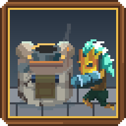

# CalTD

A single-player maze tower defence. The horde comes down from the top of
the board; you build the maze it has to walk through and the towers that
shoot it on the way. Every five waves you are dealt a hand of augments that
change how the run plays, and no two runs deal the same ones.

**[Download the latest build for Windows](https://github.com/soluxos/CalTD/releases/latest/download/CalTD.exe)** (version 0.63.0)

Every build, with what changed in each, is on the [releases page](https://github.com/soluxos/CalTD/releases).

## Running it

It is one file. Download `CalTD.exe` and run it; nothing is installed.

Windows may show a blue "Windows protected your PC" box the first time,
because the game is not signed. Choose **More info**, then **Run anyway**.

Saves and settings are kept in `%APPDATA%\CalTD`.

## Playing

- **Click** a tile on the bar at the bottom, then the board, to build.
- **Click** a tower to select it. Its upgrades and commands appear round it.
- **N** sends the next wave. **Space** changes speed. **H** holds the wave
  so you can build while nothing moves.
- **Mouse wheel** zooms. **W A S D** or the middle mouse button pans.
- **Esc** opens the menu, which lists every key.

The game is in development: expect each build to change the balance.